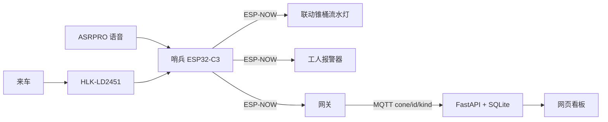
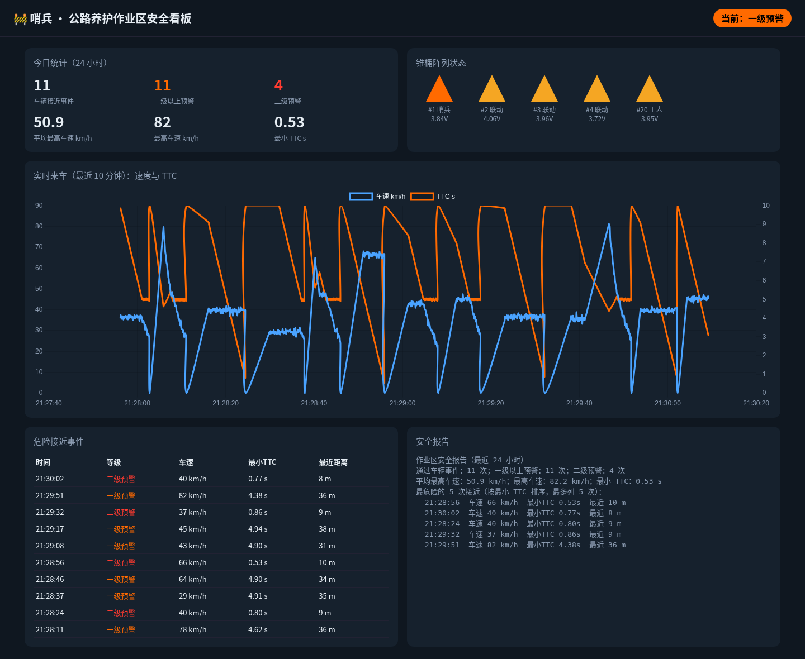

# 哨兵 · 公路养护作业区智能预警锥桶系统

[](LICENSE)
[](pyproject.toml)
[](https://github.com/wy165611/smart-warning-cone/actions/workflows/test.yml)

用可以放在普通锥桶上的雷达节点，把作业区从“只靠反光和隔离”补成一条短链路：**测到车 → 算碰撞时间 → 分级提醒司机和工人 → 把这次接近记下来**。

Python 部分可以不接硬件跑模拟和看板。四个 Arduino 草图已用 Arduino-ESP32 核心 3.3.12 编译通过（2026-11-01），但**还没有**烧录到实物上运行。本项目用于教学、竞赛和实验室联调，**没有**做过实车试验，也不能代替《公路养护安全作业规程》规定的标志、锥桶和防护设施。

**English.** Sentinel Cone is a low-cost, radar-based warning system for highway maintenance work zones. A sentinel cone measures approaching vehicles, computes time-to-collision, and raises a graded alarm. Follower cones run a light sequence, a wearable alerts the crew, and a gateway publishes MQTT messages to a small web dashboard. The Python package, simulator, and unit tests run without hardware. Field accuracy, battery life, and radio range have not been measured in this repository. See [docs/项目说明书.md](docs/项目说明书.md) for the competition write-up.

## 功能

- **哨兵锥桶**：24 GHz 雷达测距测速，卡尔曼平滑，按碰撞时间（TTC）和超速分成安全 / 一级 / 二级。
- **联动锥桶**：ESP-NOW 广播后按编号错相点亮，形成指向变道方向的流水灯；预警包最多转发 2 跳，模式配置包去重后转发一次。
- **工人报警器**：一级短震，二级持续震动和蜂鸣；按键可让声音安静 10 秒。
- **离线语音**：ASRPRO 在没有外网时切换作业、封道方向、雨天和夜间模式。
- **网关与看板**：ESP-NOW 转 MQTT，FastAPI 写入 SQLite，网页看在线状态、速度、TTC 和安全报告。
- **没有硬件也能看**：`tools/simulator.py` 向同一套主题发数据。算法、雷达帧、序号去重和 API 有单元测试，另有测试直接读取固件头文件，检查阈值和命令码与 Python 一致。

## 怎么工作




雷达帧先丢掉远离、过慢和过远的目标，再对 TTC 最小的那一个做滤波。目标消失 1.5 s 后解除告警（主循环按时间判断，雷达不出帧也能解除）。一级默认是 TTC 小于 5 秒，或速度超过限速的 1.2 倍；二级默认是 TTC 小于 2.5 秒。只开雨天时两档阈值乘 1.4，只开夜间乘 1.2，两个都开则连乘（1.68）。升级要连续 3 帧，降级立刻生效。这些数字是 `firmware/common/config.h` 里的设计默认值，**还没有用实测标定**。

## 硬件与软件

硬件清单、参考价和接线在 [docs/02-物料清单BOM.md](docs/02-物料清单BOM.md)、[docs/03-接线说明.md](docs/03-接线说明.md)。价格是物料清单里的市场估价，不是报价单。

厂家手册中的雷达指标（本仓库没有复测）：海凌科 HLK-LD2451，FMCW，24–24.25 GHz，最远感应距离 100 m，水平 ±15°、垂直 ±7°，5 V 供电且供电能力要大于 200 mA，平均电流 107 mA，串口默认 115200 8N1。手册：<http://h.hlktech.com/download/HLK-LD2451-24G/1/HLK-LD2451%E4%BD%BF%E7%94%A8%E6%89%8B%E5%86%8C_V1.03%20.pdf>。

| 需要 | 说明 |
|---|---|
| 主控 | ESP32-C3，Arduino 核心 3.x，开发板选 ESP32C3 Dev Module，并打开 USB CDC On Boot |
| 库 | Adafruit NeoPixel；网关另加 PubSubClient |
| 电脑 | Python 3.10+。看板依赖见 `pyproject.toml` |
| 联调 | MQTT broker。`server/docker-compose.yml` 带一份允许匿名的 Mosquitto，只适合实验室 |
| 可选 | `pyserial`，用于 `tools/radar_monitor.py` |

`firmware/common/config.h` 里的 Wi-Fi 名称、密码和 MQTT 地址是占位符，烧录前要改成现场的值。路由器的 2.4 GHz 信道必须固定成 `WIFI_CHANNEL`，否则 ESP-NOW 和上网不能同时工作。

## 仓库结构

| 路径 | 内容 |
|---|---|
| [docs/项目说明书.md](docs/项目说明书.md) | 竞赛用说明书：创新点、背景、研究现状、技术路线、应用前景 |
| `docs/01`–`09` | 申报书文字底稿、BOM、接线、搭建、算法、协议、测试表、答辩脚本、结构 |
| [competition/challenge-cup/](competition/challenge-cup/) | 挑战杯申报书 docx、答辩 PPT 及生成脚本 |
| `firmware/` | 哨兵、联动、工人端、网关。公共头文件在 `firmware/common/` |
| `sentinel/` | 可测试的 Python 参考实现：算法、雷达帧、序号去重、入库、API |
| `server/` | 兼容入口 `app.py`、网页、Dockerfile、compose |
| `tools/` | 模拟器、雷达串口监视、公共头文件同步 |
| `asrpro/` | 离线语音示例 |
| `tests/` | pytest |

## 安装与运行

```bash
pip install -e ".[dev]"
make test   # pytest
make lint   # ruff check + ruff format --check
```

编译固件（需要 arduino-cli）：

```bash
arduino-cli core install esp32:esp32@3.3.12
arduino-cli lib install "Adafruit NeoPixel" PubSubClient
make firmware   # 依次编译 sentinel / follower / worker / gateway
```

重新生成竞赛文件（需要 `pip install -e ".[competition]"` 和 LibreOffice）：

```bash
make competition   # 图表 → 申报书 docx → 答辩 pptx → 各自的 PDF
```

看板（先有 MQTT，或让它在后台重试）：

```bash
# 实验室 broker + 看板。compose 的构建上下文是仓库根目录
cd server && docker compose up --build

# 或者本机已经有 broker 时
python -m sentinel
# 等价于：python server/app.py
```

环境变量：`MQTT_HOST`、`MQTT_PORT`、`DB_PATH`、`HTTP_HOST`、`HTTP_PORT`、`SENTINEL_ROOT`。默认网页是 <http://localhost:8000>。

没有硬件时：

```bash
python tools/simulator.py --host localhost
```

改完 `firmware/common/` 后同步到各草图目录：

```bash
python tools/sync_common.py
```

雷达直连电脑：

```bash
pip install pyserial
python tools/radar_monitor.py /dev/ttyUSB0 --csv test.csv
```

## 示例输出

下图是本机 MQTT broker + 看板接收 `tools/simulator.py` **模拟数据**时的截图（2026-11-01），不是路试。



文字报告的同一函数也可以脱离网页运行。下面这段同样**不是实测**，完整文件在 [docs/assets/sample_report.txt](docs/assets/sample_report.txt)。

```text
作业区安全报告（最近 24 小时）
通过车辆事件：3 次；一级以上预警：2 次；二级预警：1 次
平均最高车速：48.3 km/h；最高车速：66.0 km/h；最小 TTC：1.62 s
最危险的 3 次接近（按最小 TTC 排序，最多列 5 次）：
  00:00:00  车速 66 km/h  最小TTC 1.62s  最近 18 m
  00:30:00  车速 51 km/h  最小TTC 3.40s  最近 32 m
  01:00:00  车速 28 km/h  最小TTC 6.80s  最近 53 m
```

空数据库时，报告会写“该时段没有记录到车辆通过事件”，统计接口里的平均速度和最小 TTC 是 `null`，看板上显示为 “-”。

## 文档

竞赛正文从 [docs/项目说明书.md](docs/项目说明书.md) 读起；正式提交的申报书和答辩 PPT 由 `competition/challenge-cup/` 下的脚本生成。协议、算法和搭建步骤仍在 `docs/` 的分册里。说明书只引用核对过的公开页面；没有核对的数字留着【待补充】。

## 安全

封闭、低速的场地才能做实车试验。不要在开放道路上用真实车辆冲向作业人员。本系统是主动提醒的补充，不是防撞缓冲车，也不是标准要求的全套交通安全设施。

## 许可

[MIT](LICENSE)
