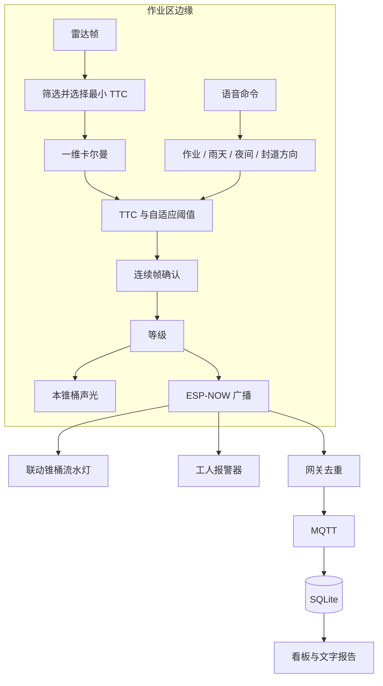

# 哨兵 · 项目说明书

公路养护作业区智能预警锥桶系统

本文给竞赛评审和后续开发看。它说明这套系统**打算**解决什么、依据哪些已经核对过的公开资料、技术上怎么做、以及还缺什么。文中的【待补充】必须由项目所有者补上原始材料后才能当成事实使用。

竞赛提交件（申报书 docx、答辩 PPT 及其生成脚本）在 [`competition/challenge-cup/`](../competition/challenge-cup/)，引用的数字与本文一致。

相关分册：[物料清单](02-物料清单BOM.md)、[接线](03-接线说明.md)、[搭建](04-从零开始搭建指南.md)、[算法](05-算法说明.md)、[协议](06-通信协议.md)、[测试表](07-测试方案与数据记录表.md)。申报书草稿在 [01-申报书.md](01-申报书.md)，其中的队员、单位和【填】栏以实际为准。

## 0. 本文做到哪一步

| 已在仓库里、可以复查 | 还没有做 |
|---|---|
| 四类节点的固件源码、协议头文件、语音示例 | 开放道路或封闭场地的实车试验 |
| Python 参考实现、模拟器、单元测试 | 雷达测距测速的误差标定 |
| 网页看板、MQTT 入库、安全报告文本 | 续航、防护等级、无线距离的测量 |
| 厂家手册和政府网页中**核对过原文**的引用 | 与某一在售产品的对比测试 |

2026-11-01 曾在本仓库做过一版软件验证（当时 `pytest` 23 项，程序空间记为 73%–74%）。下面是 **2026-11-03** 对当前源码的复跑，仍然不是外场试验：

- arduino-cli 1.5.1 + Arduino-ESP32 核心 3.3.12，FQBN `esp32:esp32:esp32c3:CDCOnBoot=cdc`，Adafruit NeoPixel 1.15.5、PubSubClient 2.8：四个草图 `--warnings all` 编译通过、无警告。程序空间上限 1310720 字节：哨兵 980009（74%），联动 967545（73%），工人端 964461（73%），网关 975527（74%）。动态内存上限 327680 字节：哨兵 36728（11%），联动 37856（11%），工人端 37800（11%），网关 39040（11%）。百分比是编译器输出。
- Python 3.12.3：`pytest` 34 项通过，`ruff check` 与 `ruff format --check` 通过。用例含非作业模式、`millis` 回绕、半包心跳、语音帧重同步，以及固件头文件里的去重窗口。
- Mosquitto 2.0.18 + `python -m sentinel` + `tools/simulator.py`：模拟器按三帧确认发预警。第一次通过的日志是最高等级 2、最高车速 37.32 km/h、最小 TTC 1.08 s、最近 11.24 m、持续 10301 ms。五个节点在线，统计和文字报告与这次事件一致。看板截图见 [assets/dashboard-sim.png](assets/dashboard-sim.png)（模拟数据）。

固件**没有**烧录到实物上运行过。编译通过只说明当前源码与上述核心、库版本能编过。

默认阈值（TTC 5 s / 2.5 s、限速 40 km/h、雨天 ×1.4、夜间 ×1.2、连续 3 帧）是设计初值，写在 `firmware/common/config.h`，由 `sentinel/algorithm.py` 用同样的数复现。它们不是标定结论。

## 1. 创新点

下面五条是本方案的设计重点，不是“已证明优于某产品”的实验结论。

1. **提醒发生在计算之后，而不是固定频率乱闪。** 哨兵用距离和速度算碰撞时间，再分成安全、一级、二级。一级同时拉动锥桶流水灯；二级才把强震动和蜂鸣送到工人身上。固定爆闪灯无法区分“有一辆车在远处”和“这辆车马上到”。
2. **同一次判断驱动两类人。** 司机看到沿过渡区移动的灯光；背对来车的工人收到穿戴端的触觉。两边用的是同一个等级，不是两套互不相干的报警器。
3. **锥桶之间不先连路由器。** 节点用 ESP-NOW 广播。Espressif 把 ESP-NOW 定义成一种无连接的 Wi-Fi 通信：数据放在厂商自定义的 action 帧里，设备之间不必先建立连接（[ESP-IDF 文档](https://docs.espressif.com/projects/esp-idf/en/stable/esp32/api-reference/network/esp_now.html)）。作业区上游往往没有现成的 Wi-Fi。网关只在需要上云时才连接路由器。
4. **部署动作可以不看屏幕。** ASRPRO 在本地识别“开始作业”“左侧封道”“雨天模式”等指令，再通过 4 字节串口帧把模式同步到全网。手套和噪声环境里，这比掏出手机改参数短。语音模块的具体 API 以所安装的天问 Block 版本为准。
5. **一次接近被记成一条事件，而不是只闪一下。** 车辆离开雷达视野后，哨兵上报这次的最高等级、最高速度、最小 TTC、最近距离和持续时间。看板据此生成文字报告。报告能不能用于管理，取决于雷达和时钟是否经过标定，目前还不能。

成本上，物料清单给出的是淘宝常见价估算（演示套装约数百元这一量级）。【待补充：实际采购报价和批量价格】在补上之前，本文不把“百元级”写成采购事实。

## 2. 研究背景

### 2.1 作业区为什么特殊

养护经常在不中断交通时进行。工人的注意力在路面上，身后是仍在行驶的车辆；司机看到的是临时压缩的车道、临时限速和一排静止的锥桶。锥桶和标志负责把路“隔开”和“说清楚”，它们本身不知道某一辆车有没有减速。

中国对这件事有明确的管理要求，但要求的是设施和管理，不是某一种雷达产品：

- 《公路养护安全作业规程》（JTG H30—2015）由交通运输部 2015 年第 16 号公告发布，自 2015 年 6 月 1 日起施行，代替 JTG H30—2004。公告写明它是公路工程行业标准，解释权在交通运输部，日常解释由交通运输部公路科学研究院承担（[公告](https://xxgk.mot.gov.cn/jigou/glj/202006/t20200623_3312282.html)）。标准著录信息写明其适用范围是各等级公路养护作业控制区布置、安全设施布设和安全作业管理（[国家标准馆著录](https://www.ndls.org.cn/standard/detail/68f700db0a19e3be5b776a289c727b87)）。本文没有逐条引用规程正文，因为没有在这里打开标准全文。
- 《公路安全保护条例》要求养护作业人员穿着统一的安全标志服，养护车辆和机械设置明显作业标志并开启危险报警闪光灯（条例文本见交通运输部政府信息公开页，[第五十二条](https://xxgk.mot.gov.cn/jigou/fgs/202006/t20200623_3307992.html)）。主动报警是在这些义务之外的补充，不是替代。

本仓库**没有**核对到可以引用的全国公路养护作业区事故起数或死亡人数。【待补充：数据来源】若要在申报书里写“事故有多少”，请使用交通运输部、公安部或正式出版文献中的原始表格，并附上可以打开的链接或书目信息。不要沿用没有出处的百分比。

### 2.2 国外统计说明这是被记录的风险

美国联邦公路局（FHWA）工作区统计页汇总了美国国家公路交通安全管理局 FARS 的数据，并注明页面数字反映的是截至 2024 年 4 月 NHTSA 所报告的值，之后可能修订（[Work Zone Facts and Statistics](https://ops.fhwa.dot.gov/Wz/resources/facts_stats.htm)）。该页对 **2022 年**的表述可以自洽地加总，本文只引用这一年：

- 工作区交通死亡 891 人，其中驾车人或乘客 742 人，行人和骑自行车的人 145 人，其他 4 人；
- 工作区致死事故 821 起；
- 涉及追尾的致死事故 174 起（约占该年工作区致死事故的 21%），超速为因素的 281 起（约 34%）；
- 道路施工现场公路工人职业死亡 94 人（2021 年为 108 人）。

同一页面里，2021 年死亡人数在两处图注中分别写成 956 和 963。两处对不上，所以本文**不**把 2021 年总数写成一个确定数字。

FHWA 在 2026 年全国工作区安全周发布的宣传页（FHWA-HOP-26-060，数据来自 FARS 2023 终版和 2024 年度报告文件）给出了更新的数字：2024 年工作区死亡 850 人（2023 年 905 人）；超过一半的工作区致死事故发生在夜间；追尾占致死事故的近四分之一；超速是三分之一以上致死事故的因素（[Fact Sheet PDF](https://ops.fhwa.dot.gov/publications/HOP-26-060_FHWA_NWZAW_Factsheet.pdf)）。答辩 PPT 和申报书引用的是这一组 2024 年数字。

这些都是美国的统计，不能用来描述中国。

FHWA 在“推进夜间工作区安全”专题中还写道：2023 年大约一半的工作区致死事故发生在夜间；2023 年超过 30% 的工作区致死事故与较高车速有关。同一页把自动入侵报警解释为“车辆进入工作区时提醒工人”的措施之一（[EDC-8 页面](https://www.fhwa.dot.gov/innovation/everydaycounts/edc_8/nighttime_work_zone_safety.cfm)）。夜间和速度都是本方案把“夜间模式”“超速”做成可切换条件的原因，但 1.2 倍限速和 ×1.2 夜间系数仍然是未经标定的初值。

### 2.3 和现行政策怎么接

只写已经打开过全文或官方摘要的文件，不把政策说成“已经要求采购本产品”。

- 《交通强国建设纲要》提出构建安全、便捷、高效、绿色、经济的现代化综合交通体系（[国务院公报](https://www.gov.cn/gongbao/content/2019/content_5437132.htm)）。本项目只落在“作业区多一种低成本感知”这一点上，不承担纲要里的其他目标。
- 《关于推进公路数字化转型 加快智慧公路建设发展的意见》（交公路发〔2023〕131 号）要求推动养护业务数字化，并写明鼓励精准化、低成本的路网监测感知和路侧信息发布装备（[交通运输部公开页](https://xxgk.mot.gov.cn/jigou/glj/202309/t20230920_3922478.html)）。看板上的事件记录是朝这个方向的一个很小的数据源，不是该意见所说的全生命期“一套模型、一套数据”。
- 国务院安委会 2024 年 1 月印发的《安全生产治本攻坚三年行动方案（2024—2026年）》把“技防”列进安排，应急管理部的报道写到要在包括交通运输在内的行业加强风险监测预警（[应急管理部](https://www.mem.gov.cn/xw/yjglbgzdt/202402/t20240205_477370.shtml)）。本系统属于作业现场的一种技防尝试，方案文本并没有点名锥桶雷达。

## 3. 国内外研究现状

### 3.1 国内

公开的、本次核对过的国内依据主要是作业区**怎么布设、人员怎么防护、养护数据怎么数字化**，也就是上一节的 JTG H30、公路安全保护条例和交公路发〔2023〕131 号。它们规定或鼓励的是控制区、安全设施和管理数字化，没有规定必须使用某一型号的毫米波雷达锥桶。

【待补充：数据来源】国内论文、学位论文和在售“智慧锥桶 / 智慧作业区”产品的名称、价格、探测距离。未逐条打开原文之前，本文不列举商品名，也不写“国内尚无”或“国内首次”。申报书草稿里若出现这类句子，投之前应改成带链接的表述，或删掉。

可以讨论、且不依赖具体品牌的差距是：

- 普通锥桶和固定频率爆闪灯不计算某一辆车的 TTC；
- 压感管、红外对射一类装置要等车辆已经进入检测线才报警，提前量取决于那条线放在多远，而不是取决于这辆车当前的速度；
- 带情报板和专网的大型系统能做更多的事，也更重，小型养护未必搬得动。

这是功能分类，不是对某个厂家的测评。

### 3.2 国外

美国联邦法规 23 CFR 630.1108 把工作区安全措施分成积极防护、减少暴露和其他交通控制。其他交通控制的举例里包括入侵报警（intrusion alarms）、速度管理和智能交通系统。条文同时写明，执法车辆不能代替 MUTCD 第 6 部分要求的临时交通控制设施（[eCFR](https://www.ecfr.gov/current/title-23/chapter-I/subchapter-G/part-630/subpart-K/section-630.1108)）。因此在美国的制度语言里，入侵报警是**可以考虑的措施之一**，不是取代标志和隔离的理由。本方案同样把自己放在补充位置。

Gambatese、Lee 与 Nnaji 2017 年提交给俄勒冈州交通厅和 FHWA 的报告（报告号 FHWA-OR-RD-17-14）把工作区入侵报警定义成：车辆闯入后提醒现场人员、争取撤离时间的系统。报告综述写到，此前研究结论不一，所以用得不多；他们在受控条件和实际作业区做过测试，但样本量有限，并认为视觉、声音和触觉报警都可能有效（[ROSA P 记录](https://rosap.ntl.bts.gov/view/dot/32574)）。本文引用的是这条记录页上的著录和摘要，没有复述报告里的试验数据表。

和那类“已经闯入再报警”的装置相比，本方案的**设计**是在哨兵仍能测到车的时候用 TTC 提前分级。这是目标上的差别。差别有没有变成更长的提前量，要靠同一场地、同一交通条件下的对比试验。这样的试验还没有做。

FHWA 的夜间工作区专题把自动入侵报警列为正在推动的措施，同时也列出防眩照明、正防护、反光服和可变限速等，说明单一报警器不被该专题当成充分条件（见 2.2 的链接）。同一页还写到：顺序点亮的警示灯（sequential lights）和高反光膜能让标志在更远处被看见、促使车辆更早并道；田纳西州交通厅评估过装在防撞缓冲车上、在车辆接近有撞击危险时自动鸣笛亮灯的系统。也就是说，“流水灯引导”和“来车接近时自动报警”在国外都有对应实践，本方案不是这两个方向的首创，差别只在于把它们和 TTC 分级、工人穿戴端、事件记录放进同一个低成本节点。

【待补充：数据来源】欧洲、日本或其他国家的产品手册与标准条款。未打开原文，本文不写具体型号。

### 3.3 本方案放在哪一层

```text
被动设施（锥桶、标志、隔离）        规程已经要求，本系统不替换
        │
提前预警（雷达 + TTC + 分级声光/震动）  本方案所处的一层，尚未用试验证明效果
        │
闯入报警（车辆越过检测线之后）        文献里已有一类产品，提前量不同
        │
减轻后果（防撞缓冲车等）              本系统不做
```

## 4. 技术路线

### 4.1 总结构



四类节点和平台的分工：

| 节点 | 编号约定 | 做什么 |
|---|---|---|
| 哨兵 | 1 | 雷达、算法、声光、语音、广播 |
| 联动锥桶 | 2 起，沿来车方向递增 | 接收、错相流水灯、最多再转发 2 跳 |
| 工人报警器 | 20 起 | 只对预警包作出震动和声音 |
| 网关 | 不参与预警逻辑 | 把 ESP-NOW 变成 `cone/<id>/{alert,heartbeat,event,config}` |
| 看板 | 电脑或服务器 | 订阅 MQTT，提供 REST 和网页 |

示意图（矢量图，不是照片）：[assets/architecture.svg](assets/architecture.svg)。

### 4.2 关键技术选择

**雷达。** 选用海凌科 HLK-LD2451。厂家说明书 V1.03（2024-08-21）写明：24 GHz FMCW，用于室外车辆状态检测，最远感应距离 100 m，水平 ±15°、垂直 ±7°，5 V 且供电能力大于 200 mA，平均工作电流 107 mA，串口 115200、1 位停止位、无校验，检测到目标时约 100 ms 输出一帧（[使用手册 PDF](https://h.hlktech.com/download/HLK-LD2451-24G/1/HLK-LD2451%E4%BD%BF%E7%94%A8%E6%89%8B%E5%86%8C_V1.03%20.pdf)）。这些是厂家指标。超声波只有数米量级、受风和温度影响大，所以没有用作主传感器；这个理由是工程判断，不是对比试验。

串口上报格式以《LD2451 串口通信协议 V1.03》表 8、表 9 为准：帧头 `F4 F3 F2 F1`，长度小端，帧尾 `F8 F7 F6 F5`；每个目标 5 字节，角度为“字节减 0x80”，方向 `0x01` 靠近、`0x00` 远离（[协议 PDF](https://h.hlktech.com/download/HLK-LD2451-24G/1/LD2451%20%E4%B8%B2%E5%8F%A3%E9%80%9A%E4%BF%A1%E5%8D%8F%E8%AE%AE%20V1.03.pdf)）。同一文档第 9 页的文字示例和表 9 对靠近/远离的叙述不一致。固件和 `sentinel/radar.py` 都按表 9 实现，并用文档中的那帧十六进制例子做了单元测试。【待实机核对】若 App 上的方向与表 9 相反，要改解析，不能只改说明书。

**主控。** ESP32-C3，因为同一颗芯片能跑 ESP-NOW，网关场景还能跑 Wi-Fi。价格见物料清单估算。【待补充：实际采购价】

**滤波与 TTC。** 距离和速度各用一个一维常值卡尔曼（过程噪声 Q = 0.5，测量噪声 R = 4，与 `kalman.h` 一致）。卡尔曼滤波的出处是 Kalman（1960）（文献 18）。TTC 用“保持当前速度和路径时距离碰撞还剩多少时间”衡量危险程度，Hayward（1972）把它作为交通冲突的危险尺度提出（文献 17）。

$$
\mathrm{TTC} = \frac{d}{v / 3.6}
$$

$d$ 为米，$v$ 为 km/h。速度不超过 1 km/h 时返回 99 s，避免除零。多目标时选 TTC 最小且满足“靠近、速度 ≥ 5 km/h、距离 ≤ 100 m”的一个。二维“距离—速度”模型在算法分册里留作后续，当前固件没有用。

**分级。** 设雨天、夜间打开时的放大系数为 $k$（都不开则 $k=1$，只下雨为 1.4，只夜间为 1.2，两者都开为 1.68）：

- 二级：$\mathrm{TTC} < 2.5k$ 秒；
- 一级：未到二级，但 $\mathrm{TTC} < 5k$ 秒，或速度大于限速 × 1.2；
- 否则安全。

比较是严格小于，所以 TTC 刚好等于 2.5 s 时落在一级而不是二级。升级需要连续 3 帧，确认计数停在 3，避免长时间跟踪把计数一直加下去；降级马上生效。目标消失后保持告警 1.5 s 再解除，解除时实时速度和距离清零，极值留在事件里。非作业模式只留暗黄灯：不累计确认、不记通过事件，结束作业的同一轮循环把等级清成安全再广播。

这些系数没有引用到某条制动距离公式的实测拟合。【待补充：数据来源】若答辩需要解释 5 秒和 2.5 秒，应写成“设计初值，拟用封闭场地数据修改”，不要写成“实验证明”。

**组网。** 每个包带 32 位序号，节点上电时随机起号。联动锥桶、工人端和网关按发送者（0–255 共 256 个槽）去重，实现是 `protocol.h` 的 `seqIsNew()`：同号丢弃；比上次小但相差不到 64 视为迟到的中继副本；相差更多视为对方重启，照常接受；从没见过的发送者第一包一定接受（包括序号 0）。同一规则在 `sentinel/dedupe.py` 里有 Python 版本和单元测试。工人端只对预警包去重、不转发；不去重的话，解除之后迟到的二级副本会把震动重新打开。预警包的模式不是“作业中”时，接收端回到安全，不把旧等级留到下次开工。预警包最多转发 2 跳，中继包经队列由主循环发出；模式配置包没有跳数字段，联动锥桶对每个序号只转发一次，所以远处锥桶也能收到“左侧封道”“雨天模式”等切换，且不会无限循环。心跳和事件包不转发，网关需要在哨兵和各节点的直接通信范围内。

**解除。** 目标消失超过 1.5 s 后解除告警并上报本次事件。这个判断放在主循环里按时间做，而不是只在收到“无目标帧”时做：LD2451 无目标时约 1 s 才出一帧，串口线松脱时则完全没有帧，只靠帧驱动会让告警一直挂着。

ESP-NOW 与网关要上网的 Wi-Fi 必须在同一信道。固件在信道不一致时打印警告，没有强行改信道，因为那样会断开路由器。

**平台。** MQTT 主题和 JSON 字段见协议分册。服务用 FastAPI 和 SQLite，适合一台电脑上的演示。坏的 JSON 会记日志并丢弃，不再让订阅线程因为缺字段退出。没有事件时，平均速度和最小 TTC 用空值表示，报告写明没有车辆通过，避免把“没有数据”印成“最小 TTC 为 0 秒”。`server/mosquitto.conf` 允许匿名访问，只能放在实验室网络。【待补充：若要接到公网或单位内网，认证、TLS 和数据库都要另做设计】

**工人端。** 二级才响蜂鸣；按键后 10 秒内不再响，震动仍在。这是为了让工人确认后还能听清现场，同时身体上的提醒不消失。10 秒是初值。

### 4.3 软件怎么对照固件

| 固件 | Python |
|---|---|
| `firmware/sentinel/sentinel.ino` 里的等级、确认帧、TTC | `sentinel/algorithm.py` |
| `firmware/sentinel/ld2451.h` | `sentinel/radar.py` |
| 联动锥桶、工人端、网关的 `seqIsNew()` 去重 | `sentinel/dedupe.py` |
| 语音帧 `AA 55 CMD SUM` | `sentinel/voice.py` |
| 网关发出的 JSON | `sentinel/ingest.py` |
| 看板统计和报告 | `sentinel/api.py`、`sentinel/report.py` |

`pytest`（2026-11-03 为 34 项）覆盖边界（TTC 刚好等于阈值、超速刚好 1.2 倍、三帧确认、非作业模式、`millis` 回绕、官方协议示例帧、语音帧重同步、坏 MQTT 消息、空报告、序号去重）。`tests/test_firmware_consistency.py` 直接读取 `firmware/common/config.h`、`protocol.h` 和各草图，检查阈值、卡尔曼参数、语音命令码、模式位、去重窗口与 Python 一致，并检查四个草图目录里的头文件副本与 `common/` 完全相同、三个接收端都调用 `seqIsNew()`、Wi-Fi 凭据仍是占位符。测试通过只说明程序和这些夹具一致，不说明雷达在路上准。

### 4.4 演示数据长什么样

[assets/sample_report.txt](assets/sample_report.txt) 是虚构事件经过真正的 `format_report()` 之后的文本，用来说明版式。2026-11-03 模拟器联调产生的报告是另一份，数字以第 0 节和测试记录表为准，不要把示例文本或模拟器日志写成路面成绩。测试记录表里的实物格子仍是空的，见 [07-测试方案与数据记录表.md](07-测试方案与数据记录表.md)。

## 5. 应用前景

前景指的是**如果**标定和结构做完，它可能用在哪里，以及规模化之前必须先有的条件。不是部署计划，也没有用户单位。

**可能有用的场景。** 据《2025 年交通运输行业发展统计公报》，2025 年末全国公路里程 557.89 万公里，其中农村公路 471.12 万公里（[交通运输部](https://xxgk.mot.gov.cn/jigou/zhghs/202606/t20260618_4207752.html)）。里程只说明养护面广，不等于设备需求量。占一条车道、当天收工的小型养护：上游需要一段提前量，工人人数少，不值得为一天的活上大型情报板。县乡公路和城市道路的日常修补比封闭的高速公路大修更接近这个用法。系统应当加在 JTG H30 已经要求的控制区之上，锥桶该摆还是要摆。

**规模化之前要先测量的东西。**

- 雷达在锥桶高度、塑料外壳和来车偏角下的距离、速度误差，以及雨雾里的漏报和误报；
- 一级报警触发到车辆到达哨兵位置的时间，是否比“什么都不闪”或“固定爆闪”更早让司机减速——这需要封闭场地和对照，不能用模拟器代替；
- ESP-NOW 在车流和护栏环境里的丢包和端到端延迟。厂家对 ESP-NOW 的一般性描述不能当成这条链路的毫秒数；
- 18650 供电在灯带全亮时的续航，以及夏季外壳内的温度；
- 一个市或一条公路上百个节点时，SQLite 单文件和匿名 MQTT 都不够，要换成有认证的 broker 和正式的数据库。【待补充：目标部署规模】

**不适合承诺的用法。** 替代防撞缓冲车；在未标定前作为执法处罚的测速证据；在未做防水和电气安全设计前作为长期无人值守设备卖给养护单位。

物料清单里的金额是购买关键词对应的公开标价估算。批量生产还要加上外壳开模、认证和备件，这些都没有报价。【待补充：实际采购价与认证路径】

## 6. 参考文献

只列本次打开过记录页或正文的资料（最近一次核对：2026-11-01）。

1. 交通运输部. 关于发布《公路养护安全作业规程》的公告（2015 年第 16 号）. <https://xxgk.mot.gov.cn/jigou/glj/202006/t20200623_3312282.html>
2. 国家标准馆. JTG H30—2015《公路养护安全作业规程》著录信息. <https://www.ndls.org.cn/standard/detail/68f700db0a19e3be5b776a289c727b87>
3. 《公路安全保护条例》（交通运输部政府信息公开页所载文本）. <https://xxgk.mot.gov.cn/jigou/fgs/202006/t20200623_3307992.html>
4. 中共中央、国务院. 交通强国建设纲要. 国务院公报 2019 年第 28 号. <https://www.gov.cn/gongbao/content/2019/content_5437132.htm>
5. 交通运输部. 关于推进公路数字化转型 加快智慧公路建设发展的意见（交公路发〔2023〕131 号）. <https://xxgk.mot.gov.cn/jigou/glj/202309/t20230920_3922478.html>
6. 应急管理部. 国务院安委会部署开展安全生产治本攻坚三年行动. 2024-02-05. <https://www.mem.gov.cn/xw/yjglbgzdt/202402/t20240205_477370.shtml>
7. FHWA. Work Zone Facts and Statistics. 页内注明数值对应 NHTSA 截至 2024 年 4 月的发布. <https://ops.fhwa.dot.gov/Wz/resources/facts_stats.htm>
8. FHWA. EDC-8: Advancing Nighttime Work Zone Safety. <https://www.fhwa.dot.gov/innovation/everydaycounts/edc_8/nighttime_work_zone_safety.cfm>
9. 23 CFR 630.1108. Work zone safety management measures and strategies. <https://www.ecfr.gov/current/title-23/chapter-I/subchapter-G/part-630/subpart-K/section-630.1108>
10. Gambatese J A, Lee H W, Nnaji C A. Work Zone Intrusion Alert Technologies: Assessment and Practical Guidance. FHWA-OR-RD-17-14, 2017. <https://rosap.ntl.bts.gov/view/dot/32574>
11. 深圳市海凌科电子. HLK-LD2451 使用手册 V1.03. <https://h.hlktech.com/download/HLK-LD2451-24G/1/HLK-LD2451%E4%BD%BF%E7%94%A8%E6%89%8B%E5%86%8C_V1.03%20.pdf>
12. 深圳市海凌科电子. LD2451 串口通信协议 V1.03. <https://h.hlktech.com/download/HLK-LD2451-24G/1/LD2451%20%E4%B8%B2%E5%8F%A3%E9%80%9A%E4%BF%A1%E5%8D%8F%E8%AE%AE%20V1.03.pdf>
13. Espressif. ESP-NOW. ESP-IDF Programming Guide. <https://docs.espressif.com/projects/esp-idf/en/stable/esp32/api-reference/network/esp_now.html>
14. FHWA. 2026 National Work Zone Awareness Week Fact Sheet. FHWA-HOP-26-060. <https://ops.fhwa.dot.gov/publications/HOP-26-060_FHWA_NWZAW_Factsheet.pdf>
15. 交通运输部. 2025 年交通运输行业发展统计公报. 2026-06-22. <https://xxgk.mot.gov.cn/jigou/zhghs/202606/t20260618_4207752.html>
16. 国家标准全文公开系统. GB 5768.4—2017 道路交通标志和标线 第 4 部分：作业区. <https://openstd.samr.gov.cn/bzgk/std/newGbInfo?hcno=81495E87EE21D71FCC2759945539504F>
17. Hayward J C. Near-miss determination through use of a scale of danger. Highway Research Record, 1972, 384: 24-34. <https://onlinepubs.trb.org/Onlinepubs/hrr/1972/384/384-004.pdf>
18. Kalman R E. A new approach to linear filtering and prediction problems. Journal of Basic Engineering, 1960, 82(1): 35-45. <https://asmedigitalcollection.asme.org/fluidsengineering/article-abstract/82/1/35/397706/A-New-Approach-to-Linear-Filtering-and-Prediction>

## 7. 需要所有者补上的内容

1. 【待补充：数据来源】中国公路养护作业区事故或人员伤亡的官方统计。
2. 【待补充：数据来源】国内论文、在售产品和价格的可核对链接。未补上前不要写“填补空白”或“国内首次”。
3. 【待补充：数据来源】5 s、2.5 s、1.2 倍限速、雨天 1.4、夜间 1.2 的依据。现在只是 `config.h` 的初值。
4. 【待实机核对】LD2451 方向字节以表 9 还是以说明书示例文字为准。
5. 【待补充：实际采购价】BOM 中的金额和“百元级”说法。
6. 【待补充：目标部署规模】公网或单位内网部署时的认证、数据库和运维。
7. 申报书中的队员、指导教师仍是占位；学校名称“山东理工大学 交通与车辆工程学院”沿用仓库初稿，请核对。
8. `firmware/common/config.h` 的 Wi-Fi 和 MQTT 地址是占位符，烧录前替换。不要把真实密码提交进仓库。
9. 封闭场地试验记录。测试表可以填，但在填之前本文不引用任何提前量、误报率或续航。
